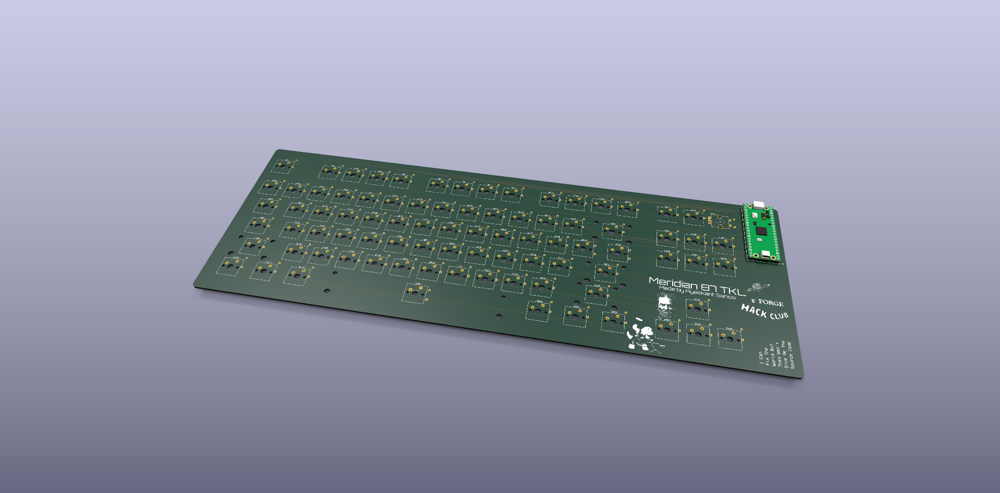
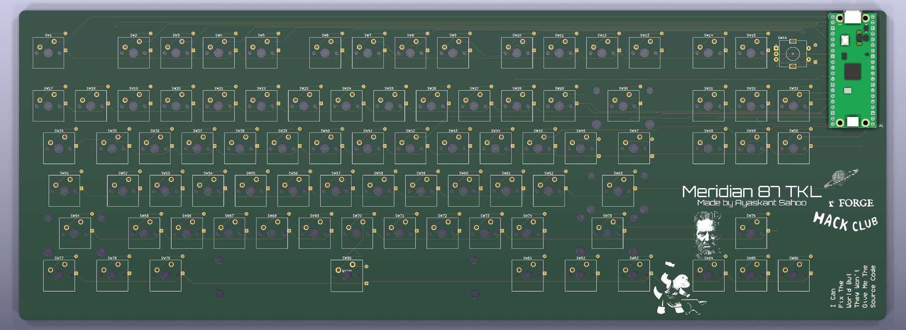

# Meridian 87

A tenkeyless mechanical keyboard with my own PCB, a Raspberry Pi Pico running QMK, and a rotary encoder where the Pause key would be. 85 soldered keys, a Tsangan-style bottom row with a 7u spacebar, screw-in stabilizers, and a 3D-printed case with a 7° typing angle.



## Why This Was Made

After building the Xeon Horizon macropad, I wanted to go all the way and design a full-size keyboard myself: the PCB, the plate, the case and the firmware, instead of buying one off the shelf.

## What It Does

- 85-key ANSI TKL layout with a Tsangan-style bottom row: 1.5u Ctrl, 1u Win, 1.5u Alt, 7u Space, 1.5u Alt, 1u Fn, 1.5u Ctrl
- Rotary encoder in the Pause slot: turn for volume, press to mute
- Hold Fn and the knob skips tracks; press it to play/pause
- Fn layer with media keys, screen brightness, Pause, a Win-key lock for gaming, an NKRO toggle and a bootloader shortcut
- Remap every key live in the browser with VIA, no recompiling
- N-key rollover over USB



## Firmware

**QMK, with the VIA keymap.** The RP2040 on the Pico is a first-class QMK target, QMK handles the 6×17 diode matrix and the EC11 encoder natively, and VIA lets you remap keys and the knob from a browser. There's no wireless, RGB or display on this board, so ZMK and KMK would only add limits without adding anything.

Prebuilt firmware is in [production/](production):

| File | Use it for |
| --- | --- |
| `meridian87_via.uf2` | Recommended. Remappable in VIA |
| `meridian87_default.uf2` | Fixed keymap, no VIA |

### Flashing

1. Hold the **BOOTSEL** button on the Pico and plug in the USB cable. A drive called `RPI-RP2` appears.
2. Drag `production/meridian87_via.uf2` onto it. The Pico reboots as a keyboard.

Once QMK is on the board you can skip the button: hold **Esc** while plugging in, or press **Fn + Esc**.

### Remapping with VIA

1. Open [usevia.app](https://usevia.app) in Chrome or Edge.
2. Go to Settings and turn on **Show Design tab**.
3. In Design, choose **Load Draft Definition** and pick [`FIRMWARE/meridian87_via.json`](FIRMWARE/meridian87_via.json).
4. Go to Configure and authorize the keyboard.

### Building From Source

1. Copy the `FIRMWARE` folder to `qmk_firmware/keyboards/meridian87`
2. Build:
   ```
   qmk compile -kb meridian87 -km via
   ```
   or `-km default` for the fixed keymap. The `.uf2` lands in the `qmk_firmware` folder.

If the knob skips or moves two steps per click, change `"resolution": 4` to `2` in `keyboard.json`. If volume goes the wrong way, swap `pin_a` and `pin_b`.

### Fn Layer

| Keys | Action |
| --- | --- |
| Fn + Esc | Bootloader (for flashing) |
| Fn + F1 / F2 | Screen brightness down / up |
| Fn + F5 / F6 / F7 / F8 | Previous / Play-Pause / Next / Stop |
| Fn + F9 / F10 / F11 | Mute / Volume down / Volume up |
| Fn + Scroll Lock | Pause |
| Fn + Win | Win-key lock |
| Fn + N | Toggle N-key rollover |
| Fn + turn knob | Previous / next track |
| Fn + press knob | Play / Pause |

## Pin Map

Raspberry Pi Pico, diodes COL2ROW (cathode toward the row).

| Signal | Pico GPIO |
| --- | --- |
| COL0 – COL16 | `GP0` – `GP16` |
| ROW0 – ROW5 | `GP17` – `GP22` |
| Encoder A | `GP27` |
| Encoder B | `GP26` |
| Encoder common | `GND` |
| Encoder push | Matrix row 0, column 16 |

## Case and Plate

The case is in `CAD/TKL_CASE.f3z` (Fusion) and `CAD/TKL_CASE.step`. Both are printed by Printing Legion.

- **Case bottom:** `Case_Bottom.step`, 400.12 × 150.9 × 36.4 mm, with 4 mm walls and a 7° typing angle.
- **Switch plate:** the `Plate_Reference` body, 400.12 × 150.9 × 1.5 mm. It sits on the case rim and is held with double-sided tape.
- **PCB:** hangs from the switches, 9 mm above the case floor. That leaves room for the diodes on the back.


## Bill of Materials

Prices were checked on 10 Nov 2026. USD is at ₹93.93 per dollar. Full links and notes are in [BOM.csv](BOM.csv).

| Name | Purpose | Qty | Cost (INR) | Cost (USD) | Distributor |
| --- | --- | ---: | ---: | ---: | --- |
| PCB, 2-layer, black, HASL (MOQ 5) | Main board | 5 | ₹2,630.04 | $28.00 | JLCPCB |
| PCB shipping (E-POST) | Delivery | 1 | ₹2,096.52 | $22.32 | JLCPCB |
| Raspberry Pi Pico | Microcontroller | 1 | ₹384.00 | $4.09 | Robu |
| 1x40 male header | Pico mounting | 2 | ₹16.00 | $0.17 | Robu |
| 1N4148 diode, DO-35 (onsemi) | Matrix diodes | 100 | ₹309.00 | $3.29 | Robu |
| EC11 encoder with switch, 20 mm | Volume knob | 1 | ₹58.00 | $0.62 | Robu |
| Knob, 15 mm | Encoder cap | 1 | ₹19.00 | $0.20 | Robu |
| Micro-USB data cable | Connect to PC | 1 | ₹49.00 | $0.52 | Robu |
| Outemu Peach v3 silent linear (10-pack) | Switches | 10 | ₹1,600.00 | $17.03 | Neomacro |
| Glorious GOAT screw-in stabilizers | 4 × 2u + 7u | 1 | ₹699.30 | $7.44 | Meckeys |
| Keychron Cherry PBT keycaps, Camel | Keycaps (incl. 7u + 1.5u mods) | 1 | ₹2,969.10 | $31.61 | Credkeys |
| Solder wire 60/40, 50 g | Consumable | 1 | ₹377.00 | $4.01 | Robu |
| Flux paste, 10 g | Consumable | 1 | ₹21.00 | $0.22 | Robu |
| Rubber bumper feet (100) | Anti-slip (optional) | 1 | ₹111.00 | $1.18 | Amazon.in |
| Case bottom + plate, 3D printed | Case | 1 | not priced | not priced | Printing Legion |
| Double-sided tape | Holds the plate | 1 | not priced | not priced | Self-sourced |

**Shipping:** Robu, Meckeys and Neomacro ship these orders free. Credkeys works out shipping at checkout.
**Grand Total:** ₹11,338.96 ($120.72). This excludes the 3D prints, tape, Credkeys shipping and any customs duty on the PCB.

## Files

| Path | What's in it |
| --- | --- |
| `PCB/` | KiCad 9 project (schematic + PCB) |
| `production/gerbers.zip` | Gerbers + drill files for JLCPCB |
| `production/Meridian87_schematic.pdf` | Schematic |
| `production/*.uf2` | Ready-to-flash firmware |
| `FIRMWARE/` | QMK keyboard definition, keymaps and VIA definition |
| `CAD/` | Case, plate DXF and Fusion source |
| `images/` | PCB renders |
